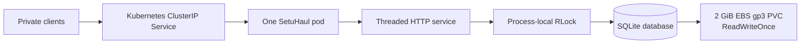
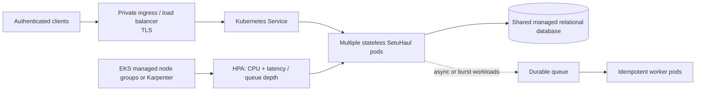
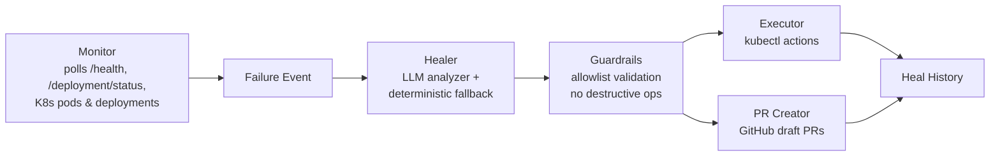

# SetuHaul deployment and scaling design

## Design intent

Keep booking decisions transactionally safe while moving from a single-facility pilot to a
multi-instance service. Scale-out is conditional on eliminating shared SQLite state and
demonstrating cross-instance correctness; adding Kubernetes replicas alone is not a scaling plan.

## Current topology

The current EKS Deployment has one replica, `Recreate` updates, CPU/memory requests of
100m / 256 MiB and limits of 1 CPU / 768 MiB. The persistent volume is single-writer storage.
The threaded HTTP server can accept concurrent requests, but stateful operations share the
process's SQLite connection and are serialized by an in-process lock. SQLite transactions and
unique indexes protect booking invariants within this single-instance design.

There is no HPA, node autoscaler, public ingress, or live cluster-status integration. The
`/deployment/status` endpoint reports app-level health/runtime and deliberately reports cluster
rollout state as unobserved.

## Target scale-out topology

### Migration and rollout stages

1. **Pilot:** retain one pod and SQLite. Establish traffic, latency, resource, lock-contention and
   booking-conflict baselines with representative load and burst tests.
2. **Shared transactional store:** migrate operational state to a managed relational database
   (PostgreSQL is a candidate). Refactor SQLite-only SQL and transaction semantics, configure
   connection pooling, and preserve atomic feasibility checks, request idempotency, and unique
   active-slot/current-appointment constraints.
3. **Multi-pod application:** verify parallel writes, retries, duplicate delivery, pod termination,
   and database failover across independent service instances. Then increase replicas and use
   rolling updates, readiness checks, graceful draining, and a PodDisruptionBudget appropriate to
   the availability target.
4. **Elastic capacity:** add an HPA using measured CPU and a custom signal such as request latency
   or queue depth. Set replica bounds from load tests. Configure EKS managed node-group scaling or
   Karpenter separately so worker capacity can meet pod demand.
5. **Burst isolation, when justified:** move slow or bursty integrations to a durable queue with
   idempotent workers, per-driver ordering, bounded retries, and dead-letter handling.

### Scale-out gate

Do not enable multiple application replicas while all pods would depend on the existing SQLite
database or process-local lock. Do not expose the service publicly until caller authentication,
inbound webhook verification, ingress policy, and TLS are implemented. The current `/deployment`
dashboard is an app/configuration view, not an EKS control-plane observer or deployment trigger.

For the API constraints and precise current manifest values, see [the technical specification](spec.md)
and [the EKS deployment guide](deploy_eks.md).

## Self-Healing Agent

SetuHaul includes a self-healing agent that monitors the service, analyzes failures,
proposes remediation, and raises pull requests for issues requiring code or config changes.
The agent runs as part of the SetuHaul service and exposes self-healing APIs under
`/self-healing/*`.

### Architecture

The agent uses a hybrid design: **deterministic execution with optional LLM analysis**.
The LLM never executes actions against the cluster; it only advises. Deterministic guardrails
validate every proposed action before anything is executed.

### Components

| Component | Responsibility | LLM? |
|---|---|---|
| **Monitor** | Polls `/health`, `/deployment/status`, K8s deployment rollout, pod restart counts, CrashLoopBackOff/ImagePullBackOff detection | No |
| **Healer** | Analyzes failure events, proposes remediation (restart, scale, investigate, PR-only) | Optional (feature flag `SELF_HEALING_LLM_ENABLED`) |
| **Guardrails** | Validates proposed actions: kubectl verb allowlist, resource allowlist, no destructive verbs (`delete`, `drain`, `cordon`, `taint`), deployment name confirmation | No |
| **Executor** | Runs validated `kubectl` commands against the EKS cluster | No |
| **PR Creator** | Opens draft PRs on GitHub for code/config fixes | No |

### Self-Healing API Endpoints

| Endpoint | Method | Purpose |
|---|---|---|
| `/self-healing/health` | GET | Agent + service health |
| `/self-healing/monitor/status` | GET | Latest monitor scan results (fresh scan on each call) |
| `/self-healing/monitor/targets` | GET | Monitored targets (service URL, K8s namespace, deployment, pods) |
| `/self-healing/heal/actions` | POST | List heal actions (optional `status` filter in body) |
| `/self-healing/heal/execute` | POST | Trigger a manual scan+heal cycle |
| `/self-healing/heal/history` | GET | Full heal action history (supports `limit` query param) |
| `/self-healing/pr/create` | POST | Create a PR (provide `action_id` or `title`+`body`) |
| `/self-healing/pr/list` | GET | List PRs created by the agent |
| `/self-healing/config/rules` | GET | Guardrail + agent configuration |
| `/self-healing/webhooks/github` | POST | GitHub webhook receiver |

### Configuration (environment variables)

| Variable | Default | Purpose |
|---|---|---|
| `SELF_HEALING_LLM_ENABLED` | `false` | Enable LLM-based failure analysis |
| `SELF_HEALING_POLL_INTERVAL` | `30` | Monitor poll interval (seconds) |
| `SELF_HEALING_GITHUB_TOKEN` | `` | GitHub PAT for PR creation |
| `SELF_HEALING_GITHUB_REPO | `` | GitHub repo (`owner/name`) for PRs |
| `SELF_HEALING_K8S_NAMESPACE` | `setuhaul` | K8s namespace to monitor |
| `SELF_HEALING_DEPLOYMENT_NAME` | `setuhaul-service` | K8s deployment name |
| `SELF_HEALING_SERVICE_URL` | `http://localhost:8080` | SetuHaul service base URL |

### Safety Guarantees

1. **LLM never executes**: The LLM only proposes actions; deterministic code validates and executes.
2. **No destructive operations**: `delete`, `drain`, `cordon`, `taint` are never auto-executed.
3. **Allowlist only**: Only `get`, `describe`, `logs`, `rollout`, `scale`, `restart` verbs are allowed against `pod`, `deployment`, `service`, `pvc`, `node` resources.
4. **Deployment-scoped**: Restart/scale commands must target the configured deployment name.
5. **PRs are drafts**: All PRs created by the agent are drafts, requiring human review before merge.
