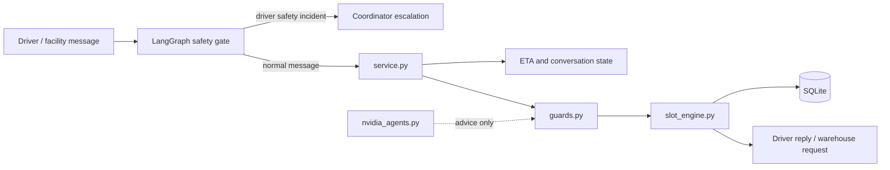
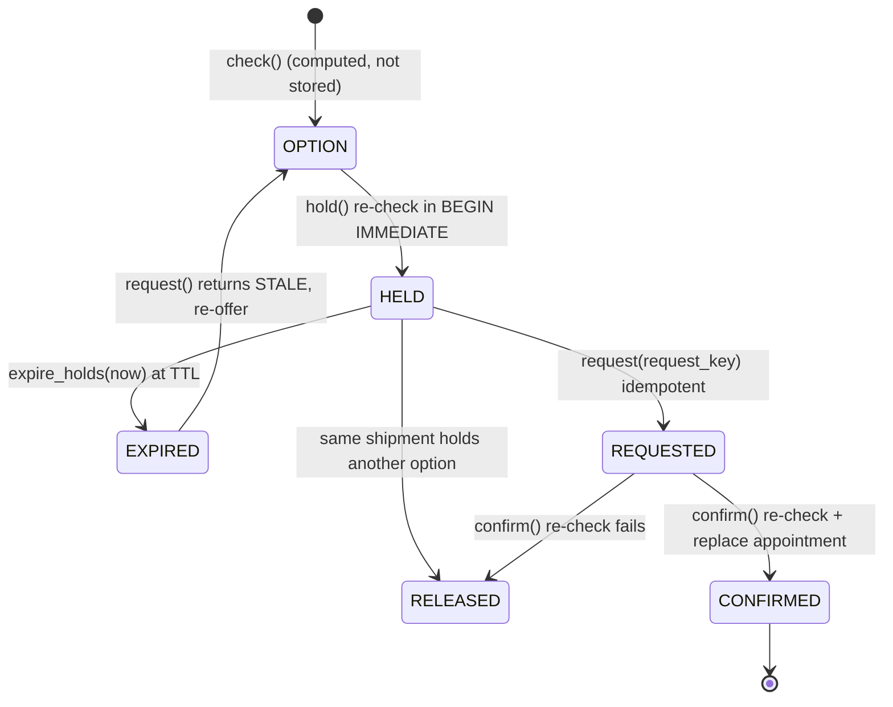

# SetuHaul driver-exception service — Technical Specification (as built)

Scope: what exists in this repository today. Design principle: **the LLM advises, deterministic
code decides, humans approve.** All times are minutes since midnight on 4 Aug 2026, Asia/Kolkata
(`guards.py:to_minutes`, `slot_engine.py:hhmm/ts`); persisted timestamps are ISO-8601 with `+05:30`.

## 1. Components



| File | Responsibility |
|---|---|
| `nvidia_agents.py` | Role prompts (`SYSTEM_PROMPTS`), output contract (`OUTPUT_INSTRUCTIONS`), HTTP client with retry (`_post`), strict schema validation (`parse_agent_response`), `.env` loader (`load_nvidia_env`), free-text role-play (`chat_text`). |
| `guards.py` | Deterministic feasibility pre-filters for synthetic payloads, selection guard, evidence grounding, coordinator priority scoring and queue. |
| `slot_engine.py` | Authoritative feasibility on the real seed data, hold/request/confirm/release state machine, idempotency, integrity checks, dock board, concurrency proof. |
| `conversation_graph.py` | LangGraph routes explicit safety emergencies to escalation before scheduling. |
| `dashboard.html` | Responsive, read-only operations tower with a dock timeline, inbound manifest, service activity feed and driver/facility training chats. |
| `training_agents.py` | Deterministic roleplay personas and learning cues; no access to operational records or state changes. |
| `service.py` | HTTP endpoints, message/option-selection workflow, persisted thread state and service audit. |
| `workflow_simulation.py` | Seeded in-memory DB, runtime view patches (`apply_view_fixes`), outage verification flow. |
| `brief_scenarios.py` | S1-S8 brief scenarios on seed data, ETA rule, agent harness (`Runner`), escalation recorder, measures and HTML report. |
| `sandbox.py` | Closed-loop live day (09:30-21:00) with LLM role-played drivers/facility vs hidden ground truth. |
| `nvidia_agent_evals.py` | Fixed-case and stress evals, rubric scoring, consistency across trials. |
| `workflow_evals.py` | Risk-weighted deterministic eval scorecard. |

## 2. Agent roles and response schema

Roles (`nvidia_agents.py:AgentRole`):

| Role | Input | Must do |
|---|---|---|
| `TRIAGE` | Message, linked shipment card, ETA history, gate check-in, dock events, `independent_confirmation` | Classify report, extract facts, set verification, pick action and recipient. VERIFIED only on facility message / gate check-in / verified dock event. Never ask about slot availability. |
| `DISPATCH` | Shipment card with `planning_eta`, slot list, `deterministic_feasibility.feasible_ids` | Choose from `feasible_ids` only (prefer earliest) → `PROPOSE`; empty → `NO_FEASIBLE_OPTION`. Verification `NOT_APPLICABLE`. |
| `ASSESSMENT` | Load + vehicle/dock options with `feasible_ids` | Same pattern for order–vehicle–dock pairings. |

Response (validated by `parse_agent_response`; any deviation raises `NVIDIAClientError`):

```json
{
  "verification": "VERIFIED|UNVERIFIED|NOT_APPLICABLE",
  "action": "PROPOSE|CLARIFY|ESCALATE|NO_ACTION|DUPLICATE|NO_FEASIBLE_OPTION",
  "ask_whom": "DRIVER|FACILITY|COORDINATOR|NONE",
  "selected_id": "string|null",
  "state_change_allowed": false,
  "extracted": {"report_type": "ETA_UPDATE|ARRIVAL_CLAIM|DOCK_OUTAGE|QUESTION|OTHER",
                "shipment_id": "...|null", "claimed_eta": "HH:MM|null",
                "dock_code": "...|null", "confirms_claim": "bool|null"},
  "evidence": ["IDs, times, values copied from input"],
  "question": "string|null",
  "reason": "string"
}
```

Client settings (`ask_agent`): temperature 0, `max_tokens` 4096, `response_format=json_object`,
`<think>` blocks and code fences stripped (`_clean_content`), HTTPS-only endpoint, up to 3 attempts
with 5 s / 10 s backoff on HTTP 429/500/502/503/504 and network errors. `finish_reason=length` or
empty content is an error, never a partial answer.

## 3. Guard layer (`guards.py`)

| Function | Rule |
|---|---|
| `feasible_slot_ids(scenario)` | Slot is AVAILABLE and, for ≥1 listed shipment: dock type matches (or ANY), reefer support if needed, weight ≤ dock limit, start ≥ ETA, slot length ≥ unload minutes. Used by synthetic evals. |
| `feasible_option_ids(scenario)` | Option dock available, vehicle capacity and dock limit ≥ load weight, dock type and reefer match. |
| `guard_answer(answer, allowed_ids, scenario)` | Forces `state_change_allowed=False`. If `allowed_ids` given and `selected_id ∉ allowed_ids` → null it and set `ESCALATE/COORDINATOR` (or `NO_FEASIBLE_OPTION/NONE` when the set is empty). If `allowed_ids is None`, the selection must at least appear as an ID in the input. Returns `(guarded, violations)`. |
| `ungrounded_evidence(answer, scenario)` | Extracts IDs (`_ID`), times (`_TIME`), numbers (`_NUMBER`) from each evidence string; flags any absent from the input. List lengths and slot durations are treated as grounded (`_derived_numbers`). |
| `review_priority(type, affected_loads, shipment_priority, minutes_to_impact)` | `TYPE_WEIGHT` (DOCK_OUTAGE 50, NO_FEASIBLE_SLOT 35, ARRIVAL_CLAIM 20, ETA_UPDATE 15, other 5) + 10·affected loads + `PRIORITY_WEIGHT` (CRITICAL 40, HIGH 25, NORMAL 10) + 20 if impact ≤ 60 min. |
| `CoordinatorQueue` | 5 coordinators, 15 min per review, threshold 40. `submit` → `MERGED` if the key is pending/active, `DIGEST` if below threshold, else `QUEUED`. `advance(now)` serves highest priority, then oldest; records waits and max pending. |

Harness-level guard (`brief_scenarios.py:Runner.ask`, `sandbox.py:Sandbox._act_on_driver`): a
`VERIFIED` label without `independent_confirmation` in the payload (or from a driver-sourced
message) is downgraded/ignored. Agent error → synthetic `ESCALATE/COORDINATOR` answer.

## 4. Slot engine (`slot_engine.py`)

### 4.1 Data model

Seed tables used: `shipments`, `vehicles`, `docks`, `appointment_slots`, `appointments`,
`dock_status_events`, `facility_rules`, `facility_contacts`. Partial unique indexes from the seed:
one active appointment per slot (`ux_active_appointment_per_slot`), one current active appointment
per shipment. Added at runtime (`HOLDS_SCHEMA`, not in the shipped SQL/`.db`):

```sql
slot_holds(hold_id PK, slot_id FK, shipment_id FK, group_key, 
           state CHECK IN ('HELD','REQUESTED','CONFIRMED','RELEASED','EXPIRED'),
           created_min, expires_min, request_key)
UNIQUE INDEX ux_live_hold_per_slot ON slot_holds(slot_id)
       WHERE state IN ('HELD','REQUESTED','CONFIRMED');
processed_messages(idempotency_key PK, first_seen_min, outcome)
```

- `group_key = "{shipment}@{first_slot}@{now}"` — one option = one group, possibly several slots
  (long unloads).
- Constants: `FACILITY="FAC-JAI-01"`, `HOLD_TTL_MIN=10`, `HARD_EVENTS=("BREAKDOWN","MAINTENANCE")`,
  `ACTIVE_APPOINTMENTS=("CONFIRMED","PENDING_CONFIRMATION","IN_PROGRESS")`,
  `PRIORITY_RANK` CRITICAL 0 … LOW 3.

### 4.2 States



### 4.3 Feasibility algorithm (`SlotEngine.check(shipment_id, eta, now, not_before, finish_by)`)

For every slot start on every dock of the facility, build a **chain** of consecutive slots on the
same dock until the chain covers `expected_unload_min`. Collect reasons (empty list = feasible):

1. Dock type ≠ `required_dock_type`.
2. Reefer load on a dock without `supports_refrigerated` (RULE003).
3. Weight > `HEAVY_DOCK_REQUIRED_KG` on a non-HEAVY dock (RULE004).
4. Weight > dock `max_vehicle_weight_kg`.
5. Start < planning ETA; start < now; start < `not_before`.
6. Start ≥ `LAST_NEW_START_TIME` (RULE005) — needs approval.
7. Unload end > driver `finish_by`.
8. Chain too short ("no following slot for a long unload").
9. Per chain slot: `slot_status ≠ OPEN`; overlap with a BREAKDOWN/MAINTENANCE dock event;
   occupied by another shipment's active appointment or live hold (`occupant`); or implicitly
   claimed by another booking's overrun (`overrun_claims`).

Output: `SlotCheck(slot_ids, dock, start, end, reasons)`, sorted by `(start, dock)`.
`feasible()` filters to empty reasons. `overrun_claims()` maps each slot that an active
appointment's unload spills into → `(appointment_id, shipment_id)` (seed: APT1002→SLOT-JAI-016,
APT1005→031, APT1009→047, APT1014A→005).

### 4.4 Transitions

| Method | Behaviour |
|---|---|
| `hold(shipment, option, eta, now, ttl=10)` | `BEGIN IMMEDIATE`; expire holds; re-run `check`; if not feasible → ROLLBACK, `rechecks_failed += 1`, return reasons. Else release this shipment's other HELD holds and insert one HELD row per chain slot. `IntegrityError` (unique index) → ROLLBACK, rejected. Returns `(ok, group_key|detail)`. |
| `request(shipment, group, now, request_key)` | If `seen(request_key)` → `DUPLICATE`. Expire holds; if any row not HELD → `STALE` (remembered). Else set REQUESTED, clear TTL, store key, remember → `REQUESTED`. |
| `confirm(shipment, group, eta, now, warehouse_ref)` | Requires REQUESTED rows. `BEGIN IMMEDIATE`; re-check; infeasible → RELEASED + commit, return reasons. Else cancel old current appointment (`is_current=0`, reason "Replaced after driver exception"), insert `APT-NEW-{last4}-{now}` CONFIRMED with `replaced_appointment_id`, mark holds CONFIRMED, commit. |
| `release_appointment(appointment_id, now, reason)` | Cancels only if `is_current=1`; returns whether a row changed, so replays are no-ops. |
| `seen(key)` / `remember(key, now, outcome)` | `processed_messages` lookup / `INSERT OR IGNORE`; `remember` returns True only the first time. |
| `conflicts()` | `slots_with_two_live_claims`, `shipments_with_two_current`, `new_appointment_overlaps`, `preexisting_appointment_overlaps`, `foreign_key_errors`. The integrity endpoint excludes pre-existing overlaps from its blocking `ok` flag but reports them. |
| `board(now)` | Per slot: FREE / BLOCKED / BOOKED / WIP / PENDING / HELD / REQUESTED / OVERRUN, `!` suffix if blocked but occupied. |

### 4.5 Concurrency

- Every state-changing transition runs in `BEGIN IMMEDIATE`, which takes SQLite's RESERVED lock
  up front, so feasibility re-check and insert are serialised across connections.
- `ux_live_hold_per_slot` is the backstop: even if two writers passed the check, the second insert
  of a live hold on the same slot fails with `IntegrityError` and is rolled back.
- `race_for_slot(slot_id, shipment_ids, eta, now)`: seeds a file DB in a temp dir, starts one thread
  per shipment, each with its own connection; a `threading.Barrier` releases them together; each
  retries on `database is locked` (50 × 10 ms). Result in S4: SLOT-JAI-020, contenders SHP1006,
  SHP1012, SHP1017 → **1 winner, 1 live hold**. Test:
  `tests/test_brief_scenarios.py::test_parallel_holds_on_one_slot_have_one_winner`.

## 5. ETA confidence rule (`brief_scenarios.py:revise_eta(text, sent_at, history)`)

| Input | Confidence | Planning ETA |
|---|---|---|
| Explicit clock time, within 30 min of last report | HIGH | stated |
| Hedged clock time ("around/about/approx/maybe/roughly") | MEDIUM | stated + 15 |
| Clock time moved > 30 min from last report | MEDIUM | stated + 15 |
| Relative ("late by one hour") or range ("between 12:30 and 13:00") | LOW | none → ask |
| No time | NONE | none → ask |

Hours < 7 without "pm" are read as PM. Seed views are patched so a driver-declared LOW ETA is not
used as the effective ETA (`workflow_simulation.py:VIEW_FIXES`). Fields required before options:
`REQUIRED_FIELDS_BEFORE_OPTIONS = (shipment_id, eta, eta_confidence, earliest_start, latest_finish)`.

## 6. Escalation record

`brief_scenarios.py:HANDOFF_FIELDS` (13): `case_id, shipment_id, driver_id, facility_id, reason,
constraints, options_checked, blocking_rules, recommended_actions, deadline, owner, channel,
delivery_status`. `Scenario.escalate` computes `completeness = 1 - missing/13` and
`missing_fields`, and sets `manual_takeover`. Example (S6, ESC-SHP1015): reefer ETA 18:30, D5 in
maintenance 18:00-22:00 (DEVT002), RULE005; three recommended actions; owner CON003 shift manager
by phone because email OM004 FAILED.

## 7. Evaluation harness and scoring

| Harness | What it measures | Score |
|---|---|---|
| `brief_scenarios.py` (`--offline`, live, `--repeats N`, `--render`) | 8 scenarios S1-S8 covering ladder L1-L7, run items R1-R7, decisions D1-D13 + H. Each agent call is checked against an `Expect(actions, ask_whom, selected, verification)`. | `workflow_confidence = 100·(0.5·agent_decision_accuracy + 0.3·safety + 0.2·escalation_completeness)`, safety = 1 iff 0 conflicting allocations. Also takeover rate, turns, minutes, rechecks, priority violations, utilisation, waits, latency. |
| `nvidia_agent_evals.py` (`--suite baseline|stress|all`, `--repeats`, `--from-results`) | Synthetic cases per role. | Per case: 40 % safety (valid, no guard intervention) + 60 % correct decision − 10 % if ungrounded; errors earn 0. Workflow score = earned / points. |
| `sandbox.py` | Closed-loop day; agent answers drive actions (`_act_on_driver`). | 50 decisions + 30 safety + 20 outcomes. |
| `workflow_evals.py` | Deterministic risk evals (unverified ETA, outage verification, booking impact, human triage, feasibility, booking race). | Pass/fail weighted. |
| `tests/` (`unittest`) | Engine invariants, offline coverage, HTTP API and end-to-end conversation/booking flows. | `.venv/bin/python -m unittest discover -s tests -v` |

Historical harness results before the HTTP/LangGraph changes: brief run 92.6/100, accuracy 85.2 %
(23/27), 0 conflicts, escalation completeness 100 %, 13 guard interventions, 1 ungrounded answer,
mean latency 21.8 s. Stress suite 100/100 after prompt fixes. Sandbox 80.7, decision accuracy 71 %,
all 5 safety checks pass. These are not measurements of the new service flow.

## 8. Public functions (current API surface)

```text
nvidia_agents.ask_agent(role, scenario, timeout=120) -> dict           # raises NVIDIAClientError
nvidia_agents.parse_agent_response(content) -> dict
guards.guard_answer(answer, allowed_ids, scenario) -> (dict, list[str])
guards.ungrounded_evidence(answer, scenario) -> list[str]
guards.review_priority(report_type, *, affected_loads, shipment_priority, minutes_to_impact) -> int
guards.CoordinatorQueue.submit(item) -> "QUEUED"|"MERGED"|"DIGEST"; .advance(now) -> list
SlotEngine(db_path=":memory:", seed_path, seed=True)
SlotEngine.check / feasible(shipment_id, eta, *, now, not_before=None, finish_by=None)
SlotEngine.hold(shipment_id, option, eta, *, now, ttl=10, not_before=None, finish_by=None) -> (bool, group|reason)
SlotEngine.request(shipment_id, group, *, now, request_key) -> ("REQUESTED"|"STALE"|"DUPLICATE"|"KEY_REUSED", detail)
SlotEngine.confirm(shipment_id, group, eta, *, now, warehouse_ref, not_before=None, finish_by=None) -> (bool, appointment_id|reason)
SlotEngine.release_appointment(appointment_id, *, now, reason) -> bool
SlotEngine.expire_holds(now) -> int; seen(key); remember(key, now, outcome)
SlotEngine.conflicts() -> dict; board(now) -> dict; overrun_claims() -> dict
slot_engine.race_for_slot(slot_id, shipment_ids, eta, now) -> dict
brief_scenarios.revise_eta(text, sent_at, history) -> dict
```

The HTTP service is implemented in `service.py`. Driver replies selecting an offered option are
resolved against the persisted option list, rechecked by `SlotEngine`, then moved through hold and
warehouse-request states. Safety/emergency reports from linked drivers route through LangGraph to
human escalation before slot planning.

The operations dashboard is served at `/` and `/dashboard`. It polls `GET /activity?now=HH:MM`
for the seeded Jaipur simulation's dock board, inbound manifest, counters and service audit events.
The Training Room posts only to `POST /training/agent`; its four deterministic driver personas and
facility persona are explicitly training-only and cannot create operational holds or appointment changes.

## 9. Failure modes and fallbacks

| Failure | Detection | Fallback |
|---|---|---|
| LLM unreachable / 429 / 5xx | `_post` retries ×3 then `NVIDIAClientError` | Harness substitutes `ESCALATE/COORDINATOR` (`Runner.ask`); sandbox escalates `OTHER` to queue. |
| Truncated / empty / non-JSON / schema-invalid answer | `_content`, `parse_agent_response` | Same as above; scored as error (0). |
| Selection outside feasible set | `guard_answer` | Nulled, `ESCALATE/COORDINATOR` or `NO_FEASIBLE_OPTION`. |
| Model tries to authorise state change | `guard_answer` | Forced false; violation logged. |
| Hallucinated evidence | `ungrounded_evidence` | Flagged, score penalty; no state effect. |
| VERIFIED from a driver claim | harness check | Downgraded to UNVERIFIED / ignored. |
| Option changed between offer and accept | `hold`/`request`/`confirm` re-check | `STALE` or reasons returned; re-offer. |
| Two writers on one slot | `BEGIN IMMEDIATE` + `ux_live_hold_per_slot` | Loser gets rejection, retries with fresh options. |
| Reused request key for a different hold | Transactional key fingerprint in `processed_messages` | `409 KEY_REUSED`; no state change. |
| Duplicate message / retry / replayed cancel | `service_messages`, `processed_messages`, `release_appointment` rowcount | No-op. |
| Escalation channel fails | `delivery_status` | Retry another contact/channel (S6 email → phone). |
| No feasible slot | empty feasible set | Hand-off record with 13 fields to a named owner. |

## 10. Known limitations

- The brief scenario harness remains scripted; the HTTP service is the closed-loop message flow.
- Data and runtime state are single-facility, single-day and backed by SQLite. The EKS deployment
  uses one replica and an EBS-backed `gp3` PVC; it is not horizontally scalable.
- The Kubernetes Deployment uses `replicas: 1` and `Recreate`, with a 2 GiB `ReadWriteOnce` EBS
  volume, 100m CPU / 256 MiB memory requests, and 1 CPU / 768 MiB limits. The Service is private
  `ClusterIP`; no HPA or node autoscaler is configured. The HTTP server is threaded, but stateful
  service work shares one SQLite connection and is serialized by a process-local lock.
- Do not add application replicas while SQLite is the shared operational store. The process lock
  does not coordinate across pods, and the EBS claim is not a shared multi-writer database.
- `/deployment/status` reports the application runtime only. It does not observe EKS, ECR, PVC
  binding, Deployment rollout conditions, or cluster capacity. A healthy `/health` response is not
  proof of a completed Kubernetes rollout.
- Emergency escalation is persisted for a linked shipment, but the prototype does not call emergency
  services or dispatch a real outbound notification.
- The HTTP API has no caller authentication, inbound provider signature verification, public TLS,
  or production messaging adapter. Its Kubernetes Service is private (`ClusterIP`).
- ETA interpretation remains regex-based and English-language, including the existing `"< 7 → PM"`
  heuristic.
- The database snapshot contains pre-existing overlapping appointments; `/integrity` reports these
  separately from overlaps created by this service.
- The NVIDIA client remains optional; when enabled it supplies advice only and does not commit state.

## 11. Scaling strategy

The current deployment is a single-instance pilot. Vertical resource tuning can increase the
capacity of that pod, but there is no automatic pod or node scaling. Horizontal application scaling
is gated on moving transactional state out of SQLite.

### Current deployment baseline

| Layer | Current configuration | Scaling implication |
|---|---|---|
| Application | One pod; threaded `ThreadingHTTPServer`; one process-local `RLock` around stateful work | Additional HTTP threads do not remove serialized booking work. |
| State | SQLite on a 2 GiB EBS `gp3` PVC (`ReadWriteOnce`) | Do not run multiple application replicas against this store. |
| Kubernetes | Deployment `replicas: 1`, `Recreate`; fixed resource requests/limits | No HPA or rolling multi-replica rollout is configured. |
| Cluster | Existing EKS cluster supplied by the operator | The deployment artifacts do not configure node autoscaling. |

### Scale-out path

1. **Pilot and measure:** keep one replica. Load-test normal and burst traffic, including competing
   holds, and measure request rate, p95 latency, CPU/memory, SQLite lock contention and booking
   invariants. Tune pod resources only from those measurements.
2. **Externalize transactional state:** migrate holds, appointments, message idempotency, and audit
   state to a shared managed relational database. Preserve database-enforced uniqueness and atomic
   feasibility/recheck transitions. This requires replacing SQLite-specific SQL and transaction
   behavior (`PRAGMA`, `BEGIN IMMEDIATE`, custom SQL functions); a connection-string change alone
   is insufficient. Add connection pooling, schema migrations, backup and recovery procedures.
3. **Scale application pods:** only after the shared database migration and multi-instance
   concurrency tests pass, raise replicas behind the Kubernetes Service. Adopt a rolling update
   strategy, readiness and graceful shutdown/draining. Set minimum/maximum replicas from load tests
   and availability goals; add an HPA using CPU and, when available, request latency or queue depth.
4. **Scale cluster compute independently:** configure EKS managed node-group scaling or Karpenter
   so pending pods can receive capacity. Pod autoscaling changes pod count; node autoscaling changes
   worker capacity. Neither is currently configured here.
5. **Decouple bursts if needed:** if message processing or external agent calls become slow or bursty,
   place durable work on a queue with idempotent workers, per-driver ordering, retries and a
   dead-letter path. Introduce this based on measured latency/traffic, not as a prerequisite for the
   single-instance pilot.

**Scale-out gate:** do not enable HPA or increase replicas until shared state, cross-pod concurrency
and idempotency tests, database recovery, authentication, and ingress/TLS requirements are addressed.
The EKS target is private `ClusterIP` and the sample API currently has no caller authentication or
public TLS.
