# SetuHaul end-to-end agent workflow

Operational design inputs: 280-360 loads and 190-240 receiving appointments per day; 15-25 driver exception messages on a normal day, rising to 20-35 messages in a 30-minute disruption spike; five operations coordinators per shift; no live GPS feed.

```mermaid
flowchart TD
    A[New order arrives] --> B[Order & Vehicle Assessment Agent]
    B --> C[Validate transport companies, vehicle sizes, and facility docks]
    C --> D[Score feasible pairings by capacity and predicted downtime risk]
    D --> E[Dispatch Agent selects highest-reward pairing]
    E --> F[Atomically reserve a feasible dock slot]
    F --> G[Dispatch driver]
    G --> H[Monitor plans, driver reports, and facility check-ins]
    H --> I{Disruption signal?}
    I -- No --> H
    I -- Driver exception, dock event, or facility report --> J0[Suppress exact duplicates before any agent call]
    J0 --> J[Triage Agent extracts report type, shipment, ETA, dock; sets verification, action, ask_whom]
    J --> K[Cross-check shipment, ETA history, appointment, check-in, dock events, and facility rules]
    K --> HF2[Do not infer honesty or penalize without auditable evidence]
    HF2 --> L{Evidence sufficient and consistent?}
    L -- Yes --> M[Record verified state and flag overlapping active bookings]
    L -- No --> N[Mark report unverified]
    N --> HF1[Ask one concise, specific follow-up; reuse known shipment details]
    HF1 --> O{Resolved from reply or existing records?}
    O -- Yes --> M
    O -- No --> P[Queue coordinator or facility review]
    P --> HF3[Prioritize by impact; batch low-risk follow-ups]
    HF3 --> Q{Can the report be verified?}
    Q -- Yes --> M
    Q -- No --> R[Keep state uncertain; do not claim a confirmed ETA, dock outage, or booking]
    R --> S[Notify Dispatch Agent with uncertainty and next action]
    M --> T[Deterministic filter: only slots passing ETA, dock type, refrigeration, weight, duration, dock-event and occupancy checks]
    T --> T2[Dispatch Agent chooses from feasible IDs only; guard blocks anything else]
    T2 --> U{High-impact, conflicting, or manual-override decision?}
    U -- Yes --> V[Coordinator reviews recommendation and evidence]
    U -- No --> W[Dispatch Agent applies validated recovery]
    V --> W
    W --> X{Recovery action}
    X --> Y[Reassign load or reserve replacement slot]
    X --> Z[Reroute incoming vehicle]
    Y --> HF4[Send clear status and next action to driver and facility]
    Z --> HF4
    HF4 --> B

    subgraph Human_factors[Human workflow safeguards]
        HF1
        HF2
        HF3
        HF4
    end
```

Driver statements are reports, not ground truth. The package has no live GPS, so an ETA cannot be independently location-verified; use available structured records, confidence, and human confirmation where needed. A report alone must not silently mark a dock unavailable or turn a proposed slot into a confirmed booking.

Implementation: `guards.py` (feasibility filters, selection guard, evidence grounding, coordinator priority queue), `nvidia_agents.py` (agent prompts and schema), `nvidia_agent_evals.py` (scenario evals), and `sandbox.py` (live run with role-played drivers and facility staff). Coordinator alerts are ranked by impact; repeats of a pending alert are merged, and items below the review threshold go to a low-priority digest instead of a coordinator.

## Brief scenario run

The sandbox generates random personas, so it repeats a few situation types and never touches most of the brief's ladder. `brief_scenarios.py` replays one distinct scenario per brief problem from the real seed data (S1 options only, S2 missing facts, S3 rules, S4 five trucks competing, S5 world changes, S6 no slot, S7 resequence, S8 driver claims and refusals). The NVIDIA agents advise behind the guards; `slot_engine.py` owns every state change. It re-checks feasibility inside a write transaction at hold, request and confirm. Holds expire after 10 minutes. Requests and replays are idempotent, and a long unload also claims the following slot. `race_for_slot` is the concurrency proof.

- `python3 brief_scenarios.py` — live agents; writes `brief_scenarios.json` and `brief_simulation.html` (a coverage matrix plus a step-through dock board per scenario)
- `python3 brief_scenarios.py --offline` — deterministic stand-in agent, no network
- `python3 brief_scenarios.py --render` — re-render the HTML from saved JSON

Data issues the run surfaces:

- APT1014A (21,000 kg) is pending on D1, which has a 20,000 kg limit.
- 75-minute unloads (APT1002, APT1005, APT1009, APT1014A) overrun into the next booked slot.
- OM004 went to a night-shift address that has no FAC-JAI-01 contact.
